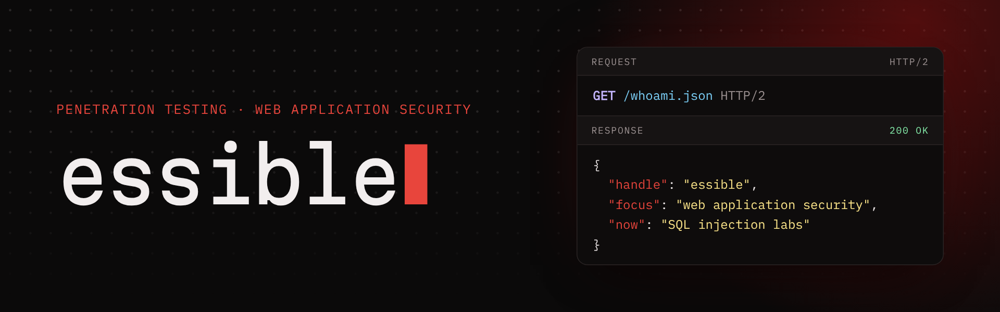

  

  
  
  

<pre align="center">
┌─────────────────────────────────────────────────────────────────────────┐
│ $ whoami                                                                │
│ essible                                                                 │
│ $ curl -s https://whoami.essible.workers.dev/whoami.json | jq -r .focus │
│ web application security                                                │
└─────────────────────────────────────────────────────────────────────────┘
</pre>

  <i>I break web apps in labs, then write up how it worked and how to fix it.</i> 
  Penetration testing · Web application security · Writeups

  

<h2 align="center" id="about">🪪 About</h2>

<i>Focused on penetration testing, starting with web applications.</i>

<table align="center">
<tr>
<td valign="top" width="50%">
<b>Right now</b>
<ul>
<li>SQL injection labs on PortSwigger's Web Security Academy</li>
<li>Writing up each topic: how the bug works, how I exploited it, how to fix it</li>
</ul>
</td>
<td valign="top" width="50%">
<b>How I work</b>
<ul>
<li>Root cause first, payload second</li>
<li>Explain why it works, not just what to type</li>
<li>For web bugs, show how a real site should prevent it</li>
<li>No passwords or flags from the platforms, ever</li>
</ul>
</td>
</tr>
</table>

  

<h2 align="center" id="writeups">📝 Writeups</h2>

<table align="center">
<tr>
<td valign="top" width="50%">
OverTheWire · 9 min read 
<b><a href="https://whoami.essible.workers.dev/writeups/overthewire-bandit/">How I solved OverTheWire Bandit (levels 0–33)</a></b>

All 34 levels, grouped by technique: the commands, why they work, and the alternatives.

<code>linux</code> <code>bash</code> <code>ssh</code> <code>networking</code> <code>git</code>
</td>
<td valign="top" width="50%">
OverTheWire · 4 min read 
<b><a href="https://whoami.essible.workers.dev/writeups/overthewire-natas/">OverTheWire Natas, levels 0–8: web security basics</a></b>

What each page exposed, how I got through, and how a real site should prevent it.

<code>web</code> <code>http</code> <code>curl</code> <code>access-control</code> <code>path-traversal</code>
</td>
</tr>
</table>

<a href="https://whoami.essible.workers.dev/writeups/">All writeups →</a>

  

<h2 align="center" id="progress">🧭 Progress</h2>

<table align="center">
<tr><th>Track</th><th>Platform</th><th>Status</th></tr>
<tr><td>Bandit</td><td>OverTheWire</td><td></td></tr>
<tr><td>Natas</td><td>OverTheWire</td><td></td></tr>
<tr><td>SQL injection</td><td>PortSwigger</td><td></td></tr>
<tr><td>Authentication</td><td>PortSwigger</td><td></td></tr>
<tr><td>Path traversal</td><td>PortSwigger</td><td></td></tr>
<tr><td>Command injection</td><td>PortSwigger</td><td></td></tr>
</table>

  

<h2 align="center" id="toolkit">🧰 Toolkit</h2>

<i>Used in labs and CTFs.</i>

  
  
  
  
  
  
  

  
  
  
  
  
  

Daily setup 
  
  
  
  

  

<h2 align="center" id="site">🛡️ This site</h2>

  <a href="https://github.com/essible/whoami"><b>essible/whoami</b></a>: the source of <a href="https://whoami.essible.workers.dev">my site</a>. A static Astro build that sets no cookies, loads nothing from third parties, and enforces a strict Content-Security-Policy with Trusted Types.

  
  
  
  
  
  

  

<h2 align="center" id="contact">📫 Contact</h2>

  
  

  <i>"Privacy is a human right."</i>

